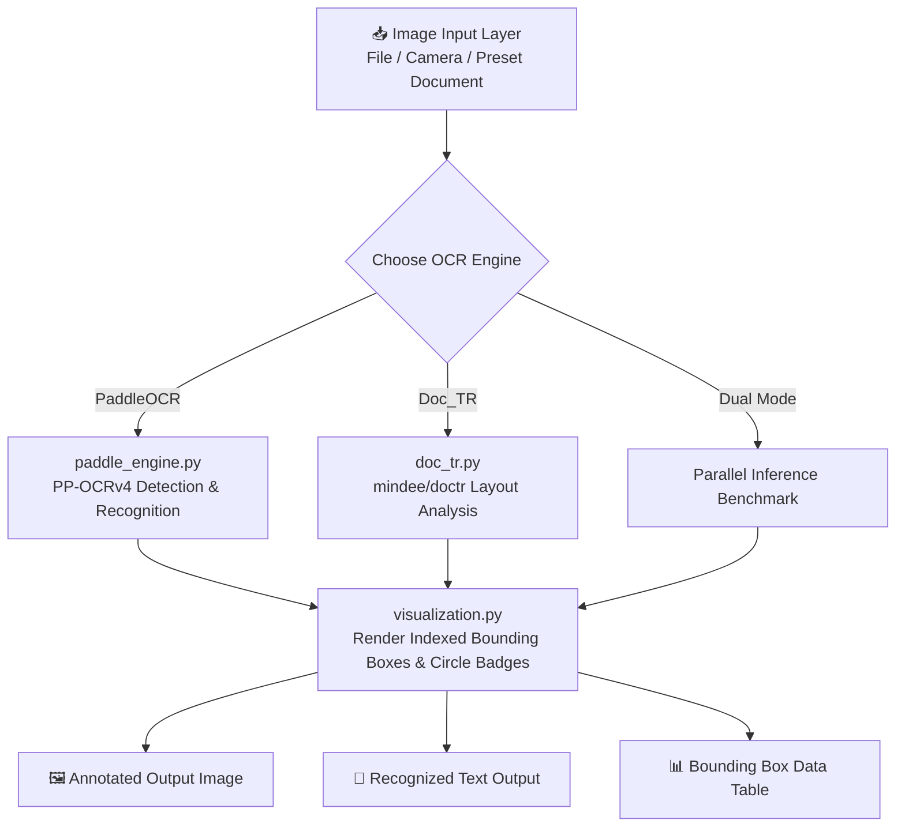

# 🔍 Deep OCR & Bounding Box Vision Studio

[](https://xsarveshpandey21.github.io/OCR-model-image-ti-text/)

> **Live Web App**: [https://xsarveshpandey21.github.io/OCR-model-image-ti-text/](https://xsarveshpandey21.github.io/OCR-model-image-ti-text/)
> An interactive document intelligence & Optical Character Recognition (OCR) input layer powered by **Gradio UI**, **PaddleOCR**, **Doc_TR**, and **Tesseract.js**.

---

## 📌 Project Overview

This repository provides an end-to-end OCR processing pipeline and interactive web interface for document analysis, tabular image scanning, and bounding box visualization. It integrates two state-of-the-art document AI engines:

1. **PaddleOCR Engine (`paddle_engine.py`)**: High-efficiency multi-language text detection using PP-OCRv4 with polygon bounding box extraction.
2. **Doc_TR Engine (`doc_tr.py`)**: Deep learning document text recognition powered by `python-doctr`, performing layout analysis and line/word level detection.
3. **Interactive Gradio Input Layer (`main.py`)**: Drag-and-drop image upload, camera capture, side-by-side engine benchmarking, index numbering (`#1`, `#2`, `#3`...), and real-time bounding box style tuning.

---

## 🏗️ Architecture Workflow



---

## ✨ Key Features

- **🎯 Indexed Bounding Boxes & Circular Badges**: Every detected text region is tagged with a high-contrast circular index badge (`#1`, `#2`, `#3`...) matching the row IDs in the coordinate table.
- **⭕ Customizable Annotation Shapes**:
  - `Box + Circle Badge`: Rectangular/Polygon outline + circular top-left index badge.
  - `Circle Highlight`: Circular highlight rings around detected document text areas.
  - `Rectangle Box`: Clean polygon bounding box outlines.
- **⚡ Dual Engine Comparison Mode**: Run PaddleOCR and Doc_TR side-by-side on the same document to compare bounding box accuracy, detection counts, and processing times.
- **📊 Granular Confidence Thresholding**: Dynamic confidence threshold slider (`0.0` to `1.0`), preventing missing boxes on dense tabular images or low-contrast spreadsheets.
- **📋 Structured Data Export**: One-click text copy and structured coordinate dataframes (`Index (#)`, `Engine`, `Text`, `Confidence`, `Bounding Box`).

---

## 📁 Repository Structure

```
OCR Model/
├── main.py              # Gradio web UI application & control panel
├── paddle_engine.py     # PaddleOCR inference wrapper & BGR image handler
├── doc_tr.py            # Doc_TR (python-doctr) inference wrapper & byte loader
├── visualization.py     # High-contrast bounding box & circle badge renderer
├── sample_generator.py  # Synthetic document generator for quick test runs
├── requirements.txt     # Environment dependencies
└── README.md            # Documentation & project guide
```

---

## ⚙️ Installation & Setup

### 1. Clone the Repository
```bash
git clone https://github.com/your-username/OCR-Model.git
cd OCR-Model
```

### 2. Install Dependencies
```bash
pip install -r requirements.txt
```

### 3. Launch the Gradio UI
```bash
python main.py
```
Open **`http://127.0.0.1:7860`** in your web browser.

---

## 💡 Python Usage Examples

### 🔹 Using PaddleOCR Engine
```python
from paddle_engine import process_with_paddle

result = process_with_paddle(
    image_input="sample_doc.png",
    min_confidence=0.1,
    box_color="cyan",
    marker_shape="Box + Circle Badge"
)

annotated_img = result["annotated_image"]  # PIL Image with circular badges
extracted_text = result["extracted_text"]  # Plain text
detections = result["detections"]          # List of dicts with bbox coordinates
```

### 🔹 Using Doc_TR Engine
```python
from doc_tr import process_with_doctr

result = process_with_doctr(
    image_input="sample_doc.png",
    min_confidence=0.1,
    box_color="green",
    marker_shape="Circle Highlight"
)

annotated_img = result["annotated_image"]  # PIL Image with circle highlights
extracted_text = result["extracted_text"]  # Recognized text content
```

---

## 📜 License

Distributed under the MIT License. Feel free to use and modify for commercial and research projects.
